<div align="center">

# 🤖 esp32-roboclaw-4x4-rover

### Rover diferencial 4x4 controlado por **Bluetooth** desde tu celular

**ESP32** &nbsp;➜&nbsp; **2 × RoboClaw 2x15A** &nbsp;➜&nbsp; **4 motores DC**


</div>

---

## 📑 Índice

1. [¿Qué es este proyecto?](#-qué-es-este-proyecto)
2. [Arquitectura](#-arquitectura)
3. [Materiales](#-materiales)
4. [Cableado](#-cableado)
5. [Ensamble y conexiones de potencia](#-ensamble-y-conexiones-de-potencia)
6. [Paso 1 · Instalar PlatformIO en VS Code](#-paso-1--instalar-platformio-en-vs-code)
7. [Paso 2 · Configurar el proyecto PlatformIO](#-paso-2--configurar-el-proyecto-platformio)
8. [Paso 3 · Configurar los RoboClaw (Motion Studio)](#-paso-3--configurar-los-roboclaw-motion-studio)
9. [Paso 4 · Compilar y cargar el firmware](#-paso-4--compilar-y-cargar-el-firmware)
10. [Paso 5 · Puesta en marcha con la app](#-paso-5--puesta-en-marcha-con-la-app)
11. [¿Cómo funciona el código?](#-cómo-funciona-el-código)
12. [Parámetros ajustables](#-parámetros-ajustables)
13. [Problemas que encontramos y cómo se resolvieron](#-problemas-que-encontramos-y-cómo-se-resolvieron)
14. [Estructura del repositorio](#-estructura-del-repositorio)
15. [Próximos pasos](#-próximos-pasos)

---

## 🚀 ¿Qué es este proyecto?

Un robot de tracción **diferencial tipo tanque** con **cuatro motores** (dos por lado) que se maneja desde el celular con la app **BT Car Controller**.

| | |
|---|---|
| 🧠 **Cerebro** | ESP32 (Bluetooth Classic SPP, sin módulos extra) |
| 💪 **Potencia** | 2 × RoboClaw 2x15A, uno por lado |
| 📡 **Comunicación** | Packet Serial con **CRC16**, un solo cable TX compartido |
| 📱 **Control** | App Android *BT Car Controller* (joysticks + velocidad) |
| 🛑 **Seguridad** | El robot se detiene si se pierde la conexión Bluetooth |
| 🌀 **Giro sobre su eje** | Con potencia mínima de giro para vencer el patinaje de las 4 llantas |
| 🐢 **Arranque suave** | Rampa de aceleración para evitar picos de corriente |

<div align="center">
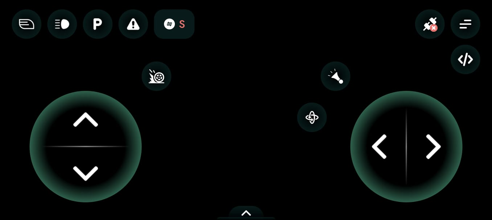
<br><em>La app: joystick izquierdo = adelante/atrás · joystick derecho = izquierda/derecha</em>
</div>

---

## 🧩 Arquitectura

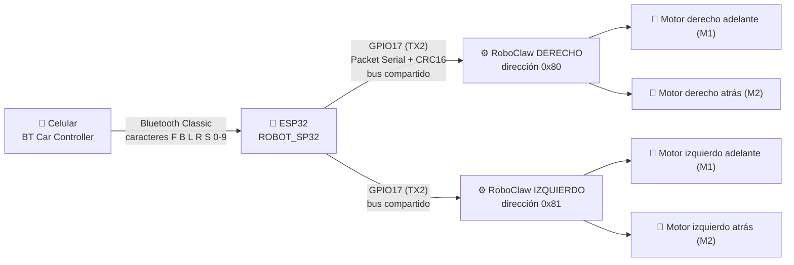

Vista superior del robot:

```
            ▲ FRENTE
   ┌─────────────────────┐
   │ [IZQ-ADEL]  [DER-ADEL] │   RoboClaw 0x81 (izq): M1 = adelante, M2 = atrás
   │   RoboClaw   RoboClaw  │   RoboClaw 0x80 (der): M1 = adelante, M2 = atrás
   │ [IZQ-ATRÁS] [DER-ATRÁS]│
   └─────────────────────┘
```

---

## 🧰 Materiales

- 1 × **ESP32** (probado con ESP32-D, placa `esp32dev`) y cable USB de datos
- 2 × **RoboClaw 2x15A** (firmware 4.2.8)
- 4 × motorreductores DC con encoder
- 1 × batería LiPo y 1 × **regulador DC-DC ajustable a 12 V** que alimenta la potencia de los RoboClaw
- Cables dupont y cable USB micro-B para configurar cada RoboClaw
- PC con **Windows/Mac/Linux**, **VS Code** y un celular Android con **BT Car Controller**

> ⚠️ **Seguridad:** en las primeras pruebas pon el robot **sobre soportes** con las ruedas en el aire.

---

## 🔌 Cableado

Los dos RoboClaw **comparten una única línea TX** del ESP32. Cada uno solo responde a su propia dirección.

| ESP32 | RoboClaw derecho | RoboClaw izquierdo |
|---|---|---|
| **GPIO17 (TX2)** | pin de señal de **S1** | pin de señal de **S1** |
| **GND** | **GND** de señal | **GND** de señal |
| GPIO16 (RX2) | *no se usa* | *no se usa* |

```
  ESP32                      RoboClaw 0x80              RoboClaw 0x81
 ┌────────┐                 ┌────────────┐             ┌────────────┐
 │ GPIO17 ├───────┬─────────┤ S1 (señal) │             │ S1 (señal) │
 │        │       └───────────────────────────────────►│            │
 │  GND   ├───────┬─────────┤ GND        │             │ GND        │
 └────────┘       └───────────────────────────────────►│            │
                            └────────────┘             └────────────┘
       (la batería de potencia se conecta aparte, a los bornes de cada RoboClaw)
```

Dónde conectar en la placa (pin de **GND** de la fila superior y pin de señal **S1** de la fila inferior):

<div align="center">
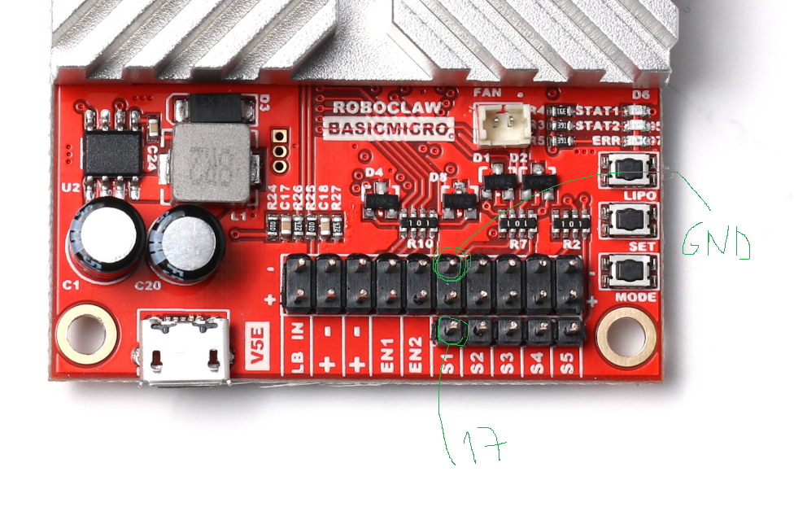
</div>

> 💡 La lógica de 3,3 V del ESP32 es compatible con la entrada S1 del RoboClaw.
> Los cables de **potencia** (batería y motores) van separados de los de **señal**.

---

## 🔩 Ensamble y conexiones de potencia

### El robot terminado

<div align="center">
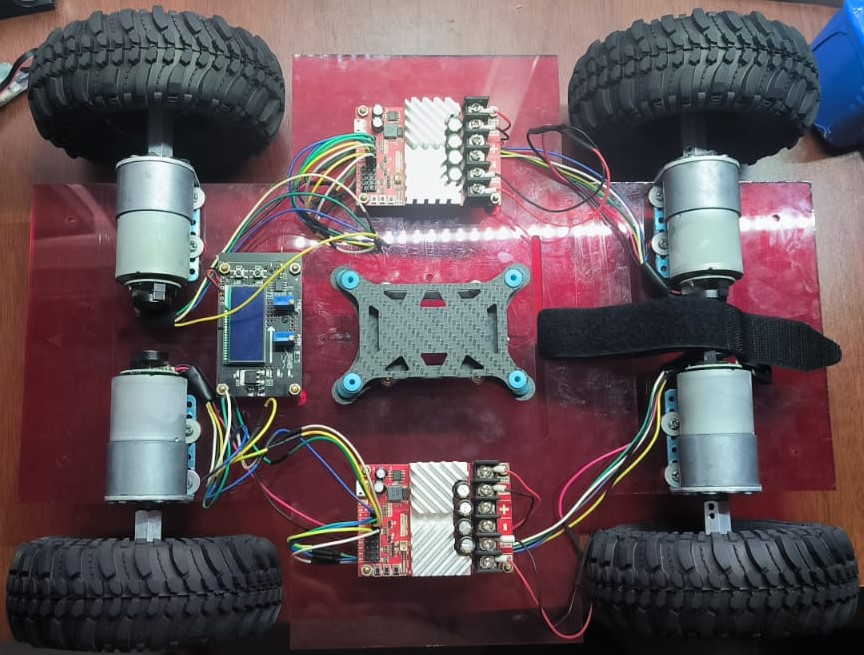
<br><em>Chasis con 4 motorreductores, 2 RoboClaw (uno por lado), regulador de voltaje y placa central</em>
</div>

<br>

<div align="center">
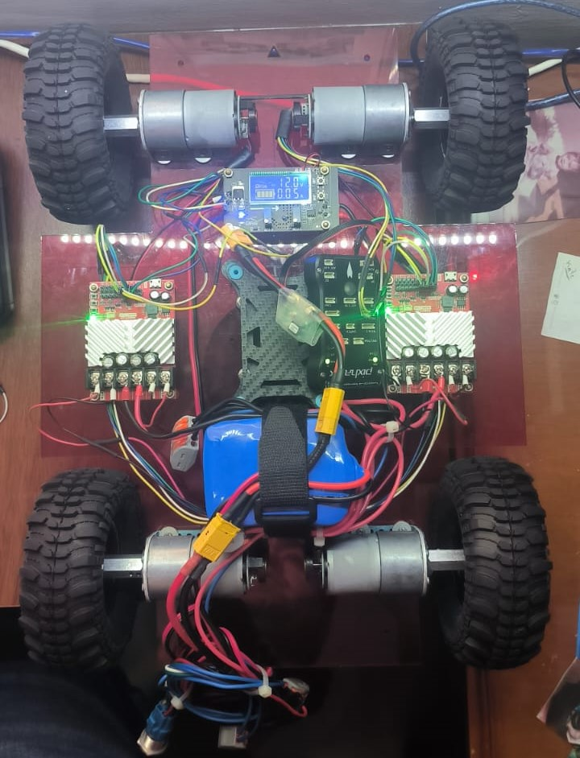
&nbsp;&nbsp;
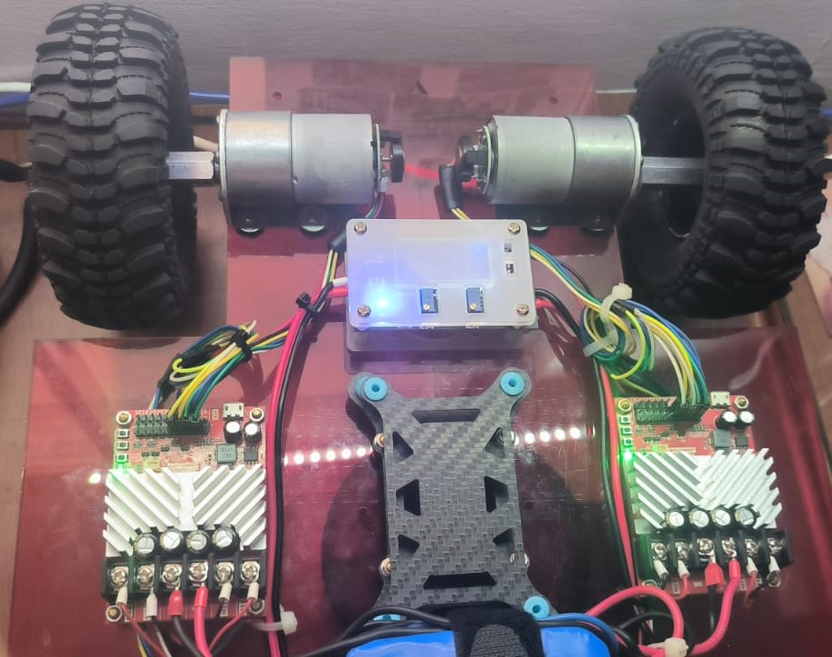
<br><em>Izquierda: vista completa con la batería LiPo y los conectores de potencia · Derecha: vista frontal de la electrónica</em>
</div>

### Alimentación: batería ➜ regulador de 12 V ➜ RoboClaw

Un **regulador DC-DC con pantalla** (ajuste de tensión y de corriente) entrega **12,0 V** a los bornes de potencia de los dos RoboClaw. Así los motores reciben una tensión estable aunque la batería se descargue.

<div align="center">
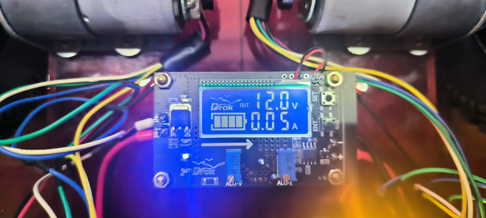
<br><em>El regulador mostrando 12,0 V de salida (0,05 A con el robot en reposo)</em>
</div>

<br>

<div align="center">
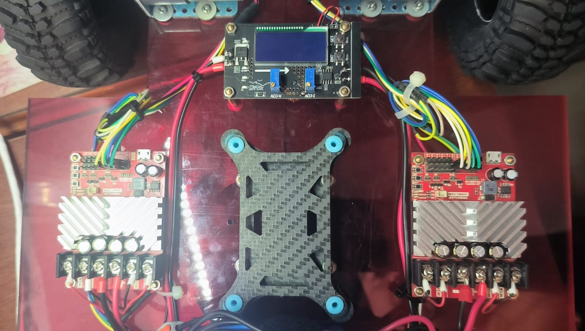
<br><em>Vista superior: los dos RoboClaw a los lados y el regulador arriba, con los cables de motor y encoder hacia cada lado</em>
</div>

### Qué es cada conector del RoboClaw

<div align="center">
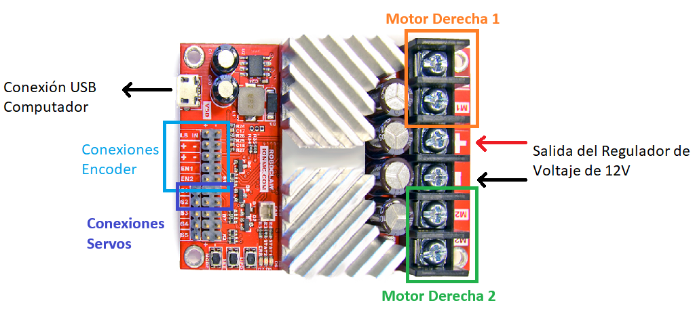
</div>

| Conector | Para qué sirve |
|---|---|
| **USB** | Configurar con Motion Studio desde el PC |
| **Bornes M1 / M2** | Los dos motores de ese lado |
| **Bornes `+` y `−` (centro)** | Entrada de potencia (salida del regulador de 12 V) |
| **EN1 / EN2** | Encoders de M1 y M2 |
| **S1 … S5** | Entradas de señal. **S1 es la del Packet Serial** que usa este proyecto |

### Motores: potencia

Cada motor lleva dos cables de potencia (**rojo** y **negro**) a los bornes de su canal:

<div align="center">
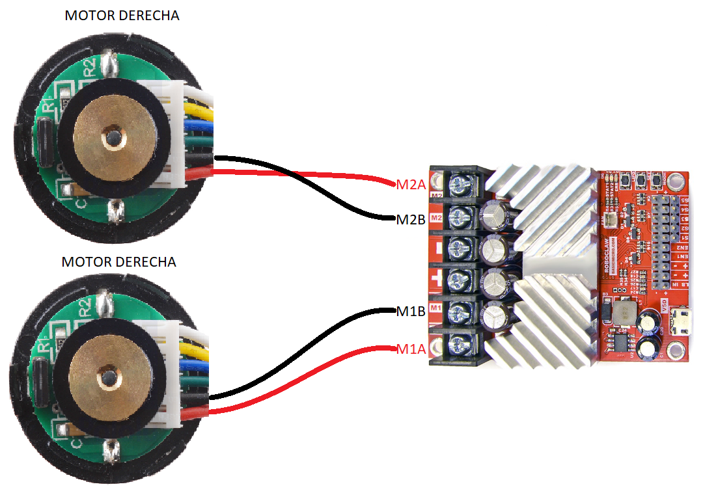
</div>

| Cable del motor | Borne del RoboClaw |
|---|---|
| Rojo / negro del motor de **M1** | `M1A` / `M1B` |
| Rojo / negro del motor de **M2** | `M2A` / `M2B` |

> Si un motor gira al revés, invierte sus dos cables de potencia, o usa `INVERT_LEFT` / `INVERT_RIGHT` en el código para invertir todo un lado.

### Motores: encoders (opcional, aún no usados en el código)

Los motorreductores traen encoder. Se conectan a **EN1** (motor M1) y **EN2** (motor M2) del RoboClaw, con el mismo esquema para el lado izquierdo:

<div align="center">
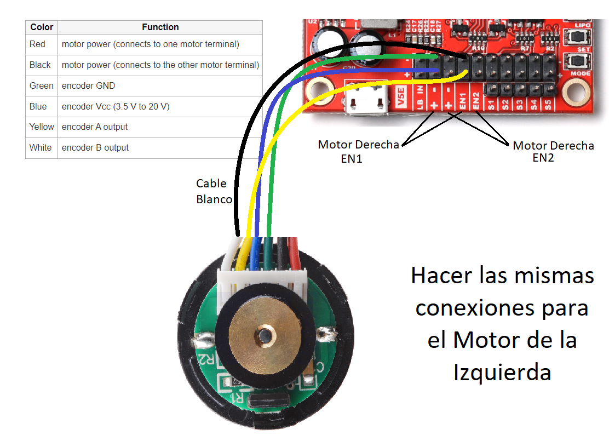
</div>

| Color | Función |
|---|---|
| Rojo | Alimentación del motor (a un borne del motor) |
| Negro | Alimentación del motor (al otro borne) |
| Verde | GND del encoder |
| Azul | Vcc del encoder (3,5 V a 20 V) |
| Amarillo | Salida A del encoder |
| Blanco | Salida B del encoder |

> Los encoders **no son necesarios** para el control por Bluetooth actual, pero quedan listos para medir velocidad y distancia (ver [Próximos pasos](#-próximos-pasos)).

---

## 🛠️ Paso 1 · Instalar PlatformIO en VS Code

1. **Instala VS Code:** <https://code.visualstudio.com/>
2. Abre VS Code y ve a **Extensiones** (`Ctrl+Shift+X`).
3. Busca **“PlatformIO IDE”** (autor *PlatformIO*) y pulsa **Install**.
4. **Reinicia VS Code** cuando lo pida. La primera vez descarga su propio Python y herramientas: tarda unos minutos y verás un icono de **hormiga 🐜** en la barra lateral.
5. Comprueba que aparece la barra azul inferior con los botones ✔ *Build*, ➜ *Upload*, 🔌 *Serial Monitor*.
6. **Driver USB del ESP32:** si al conectarlo no aparece un puerto COM, instala el driver del chip USB-serie de tu placa (**CP210x** o **CH340**).

> Opcional: para usar `pio` desde cualquier terminal en Windows, el ejecutable está en
> `C:\Users\<usuario>\.platformio\penv\Scripts\pio.exe`.

---

## ⚙️ Paso 2 · Configurar el proyecto PlatformIO

Este repositorio ya trae el proyecto listo: solo ábrelo con **File → Open Folder**.

Si quisieras crearlo desde cero: **PlatformIO Home → New Project** → placa **Espressif ESP32 Dev Module** → framework **Arduino**.

El archivo [`platformio.ini`](platformio.ini):

```ini
[env:esp32dev]
platform = espressif32
board = esp32dev
framework = arduino
monitor_speed = 115200
upload_speed = 921600
; Bluetooth Classic no cabe en la partición por defecto
board_build.partitions = huge_app.csv
```

| Línea | Para qué sirve |
|---|---|
| `platform = espressif32` | Toolchain y SDK del ESP32 |
| `board = esp32dev` | Placa genérica ESP32 (sirve para el ESP32-D) |
| `framework = arduino` | Usamos la API Arduino (`Serial2`, `BluetoothSerial`) |
| `monitor_speed = 115200` | Velocidad del monitor serie por USB |
| `upload_speed = 921600` | Carga rápida del firmware |
| `board_build.partitions = huge_app.csv` | Con Bluetooth el firmware pesa ~1,1 MB y **no cabe** en la partición por defecto (~1,3 MB) con margen. `huge_app` da 3 MB |

**No hace falta instalar librerías:** `BluetoothSerial` ya viene incluida en el framework del ESP32 y los comandos del RoboClaw están implementados directamente en el código.

---

## 🎛️ Paso 3 · Configurar los RoboClaw (Motion Studio)

### ¿Por qué Packet Serial y no RC?

| Modo | Qué permite | ¿Sirve aquí? |
|---|---|---|
| **RC** | Un pulso por canal (como un servo), sin direcciones | ❌ Necesitarías 4 salidas PWM y no hay confirmación |
| **Analógico** | Tensión 0-2 V por canal | ❌ Necesita DACs |
| **Packet Serial** ✅ | Comandos digitales con **dirección** y **CRC** | ✅ **Un solo cable** para los dos RoboClaw |

### Paso a paso

1. Descarga e instala **Motion Studio** desde <https://www.basicmicro.com/> (sección *Downloads / Software*).
2. Conecta **un RoboClaw a la vez** al PC con un cable **USB micro-B** y **aliméntalo con la batería** de potencia.
3. Abre Motion Studio → **Connect** (o *Attached Devices* → tu RoboClaw en `COMx`).
4. Ve a **General Settings** y configura:

| Ajuste | RoboClaw **derecho** | RoboClaw **izquierdo** |
|---|---|---|
| **Control Mode** | `Packet Serial` | `Packet Serial` |
| **Packet Serial Address** | `128` (= `0x80`) | `129` (= `0x81`) |
| **Baudrate** | `9600` | `9600` |
| **Timeout** | `0.5` s | `0.5` s |
| **Max Current (M1 y M2)** | `15` A (recomendado) | `15` A (recomendado) |

5. Guarda los cambios en la tarjeta con **Device → Write Settings** (escribe la configuración en la memoria del RoboClaw).
6. Repite con el **segundo RoboClaw** cambiando **solo la dirección** a `129`.
7. Verifica que **ambos** queden en el **mismo baudrate** que el código (`BAUD` en `src/main.cpp`).

<div align="center">

**RoboClaw derecho — dirección 128 (0x80)**

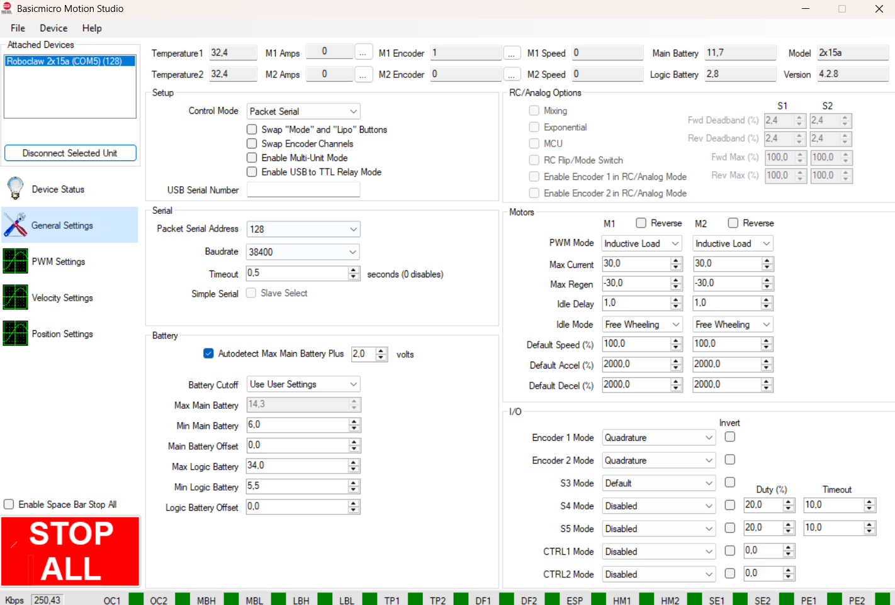

**RoboClaw izquierdo — dirección 129 (0x81)**

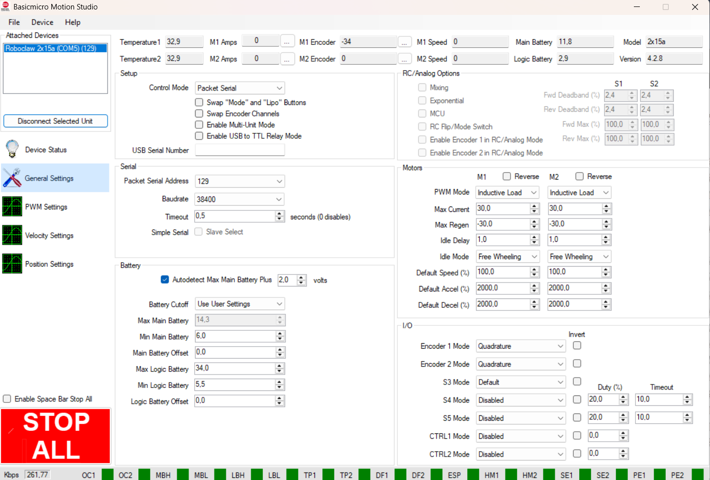

</div>

> 📝 Las capturas se tomaron con el baudrate en **38400**. Al final del proyecto se dejó en **9600**: lo importante es que el valor de Motion Studio y `BAUD` del código **sean iguales**.

### 🧪 Prueba de motores antes de usar el ESP32

En Motion Studio → **Device Status**, mueve los sliders de **M1** y **M2**. Los motores deben girar. Si no giran, el problema es de **potencia o motores**, no del código.

> ⚠️ Cierra Motion Studio y **desconecta el USB del RoboClaw** cuando pases a controlarlos con el ESP32.

---

## 📤 Paso 4 · Compilar y cargar el firmware

Con el ESP32 conectado por USB:

| Acción | Botón de la barra inferior | Comando |
|---|---|---|
| Compilar | ✔ *Build* | `pio run` |
| Cargar al ESP32 | ➜ *Upload* | `pio run -t upload` |
| Ver el monitor serie | 🔌 *Serial Monitor* | `pio device monitor` |

> 💡 Si la carga se queda en *Connecting...*, **mantén pulsado el botón BOOT** del ESP32 hasta que empiece a cargar.

Al arrancar, el monitor serie muestra:

<div align="center">
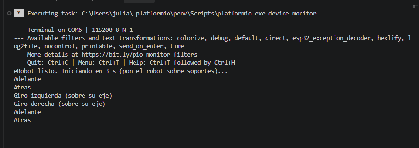
</div>

Cuando recibes comandos de la app, cada carácter aparece como `BT: 'F'`, `BT: 'S'`, etc. Es la mejor herramienta para depurar.

---

## 📱 Paso 5 · Puesta en marcha con la app

1. **Alimenta** los RoboClaw con la batería y el ESP32 (USB o fuente propia).
2. En el celular: **Ajustes → Bluetooth** y **empareja** el dispositivo **`ROBOT_SP32`** (no pide PIN, o pide `1234` / `0000`).
3. Abre **BT Car Controller**, pulsa el icono de conexión (enchufe, arriba a la derecha) y elige **`ROBOT_SP32`**.
4. **Con el robot sobre soportes**, mueve los joysticks y comprueba el sentido de cada rueda.
5. Si un lado gira al revés, cambia `INVERT_LEFT` o `INVERT_RIGHT` a `true` en `src/main.cpp`.
6. Baja el robot al suelo y ajusta la velocidad desde la app.

### 🕹️ Comandos que entiende el robot

| Carácter | Acción | Carácter | Acción |
|:---:|---|:---:|---|
| `F` | ⬆️ Adelante | `G` | ↖️ Adelante + izquierda |
| `B` | ⬇️ Atrás | `I` | ↗️ Adelante + derecha |
| `L` | ↺ Girar a la izquierda | `H` | ↙️ Atrás + izquierda |
| `R` | ↻ Girar a la derecha | `J` | ↘️ Atrás + derecha |
| `S` / `D` | 🛑 Parar | `0`–`9` | Velocidad 0 %–90 % |
| `q` | Velocidad 100 % | | |

> Los botones de luces, claxon, etc. de la app **todavía no hacen nada**.

---

## 🔬 ¿Cómo funciona el código?

Todo está en [`src/main.cpp`](src/main.cpp), en tres capas:

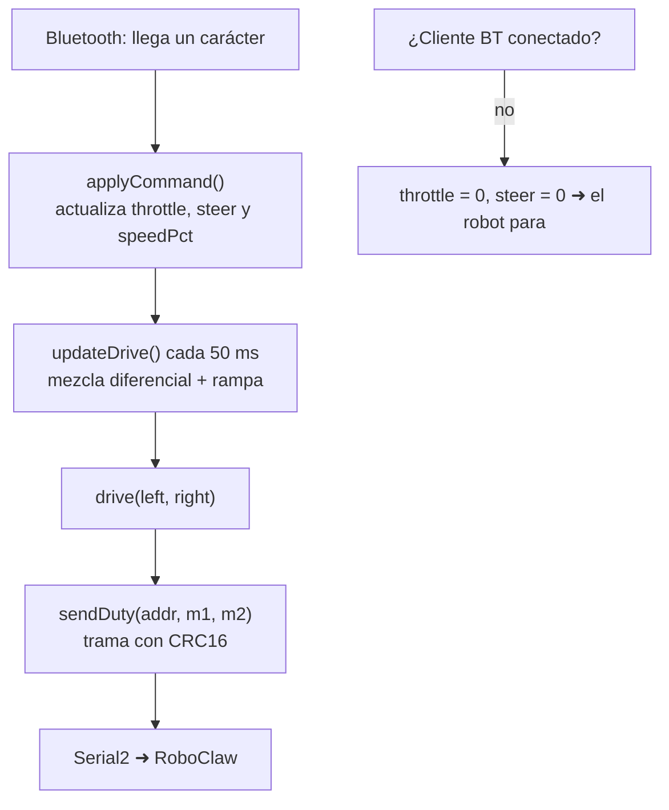

### 1) Comunicación con el RoboClaw (Packet Serial, comando 34)

Cada RoboClaw recibe **un solo paquete de 8 bytes** que fija el duty de sus dos motores a la vez:

| Byte | 0 | 1 | 2-3 | 4-5 | 6-7 |
|---|---|---|---|---|---|
| Contenido | Dirección (`0x80`/`0x81`) | Comando `34` | Duty M1 (int16) | Duty M2 (int16) | CRC16 |

- Duty: de **-32767 a 32767** (negativo = reversa).
- CRC16 tipo **CCITT** (polinomio `0x1021`, valor inicial `0`) calculado sobre los 6 primeros bytes.
- Ambos canales de un lado reciben el **mismo duty**, así las dos ruedas del lado giran juntas.

### 2) Mezcla diferencial

```
left  = clamp(throttle + steer, -1, 1) × velocidad
right = clamp(throttle − steer, -1, 1) × velocidad
```

`throttle` es −1/0/+1 (atrás/parado/adelante) y `steer` −1/0/+1 (izquierda/recto/derecha).

| Orden | throttle | steer | Izquierda | Derecha | Resultado |
|---|:---:|:---:|:---:|:---:|---|
| `F` | +1 | 0 | +v | +v | Avanza |
| `B` | −1 | 0 | −v | −v | Retrocede |
| `L` | 0 | −1 | −v | +v | Gira izquierda sobre su eje |
| `R` | 0 | +1 | +v | −v | Gira derecha sobre su eje |
| `G` | +1 | −1 | 0 | +v | Pivota hacia adelante-izquierda |

### 3) Mejoras de comportamiento

- 🌀 **Potencia mínima de giro (`TURN_MIN_PCT`)**: un robot de 4 ruedas fijas patina de lado al girar y necesita mucho más par que para avanzar. En giro puro se usa al menos ese porcentaje.
- 🐢 **Rampa de aceleración (`RAMP_STEP`)**: la salida cambia como máximo 10/127 cada 50 ms (~0,6 s de 0 a 100 %). Reduce el pico de corriente al arrancar.
- 🔁 **Reenvío continuo cada 50 ms**: mantiene vivo el *serial timeout* del RoboClaw (0,5 s) sin obligar a la app a repetir la orden.
- 🛑 **Parada por desconexión**: si `SerialBT.hasClient()` es falso, `throttle` y `steer` pasan a 0.

---

## 🎚️ Parámetros ajustables

Constantes al inicio de [`src/main.cpp`](src/main.cpp):

| Constante | Valor actual | Qué hace |
|---|:---:|---|
| `PIN_TX` / `PIN_RX` | `17` / `16` | Pines de `Serial2` hacia los RoboClaw |
| `BAUD` | `9600` | Baudrate (igual que Motion Studio) |
| `ADDR_RIGHT` / `ADDR_LEFT` | `0x80` / `0x81` | Direcciones de los RoboClaw |
| `INVERT_RIGHT` / `INVERT_LEFT` | `false` | Invierte el sentido de un lado |
| `BT_NAME` | `"ROBOT_SP32"` | Nombre Bluetooth |
| `MAX_SPEED` | `127` | Tope absoluto (0–127). Bájalo para limitar la velocidad máxima |
| `speedPct` (inicial) | `20` | Velocidad al arrancar hasta que la app mande `0`-`9`/`q` |
| `TURN_MIN_PCT` | `60` | Potencia mínima en giro sobre el eje |
| `RAMP_STEP` | `10` | Suavidad de la aceleración (menor = más suave) |

---

## 🩹 Problemas que encontramos y cómo se resolvieron

| Síntoma | Causa | Solución |
|---|---|---|
| El LED del RoboClaw parpadeaba pero **los motores no se movían** | Los comandos simples `0`-`7` con checksum de 7 bits no funcionaron con este firmware (4.2.8) | Usar el **comando 34 (duty M1/M2) con CRC16** |
| No compilaba con Bluetooth / firmware demasiado grande | La partición por defecto es justa | `board_build.partitions = huge_app.csv` |
| El robot iba **demasiado rápido** | Velocidad inicial del 50 % | Valor inicial 20 % y control de velocidad desde la app (`0`-`9`, `q`) |
| **No giraba sobre su eje** | Las 4 llantas patinan de lado y piden mucho par | `TURN_MIN_PCT` (potencia mínima en giro puro) |
| Con el giro, el **Bluetooth se desconectaba** | Pico de corriente que hunde la alimentación del ESP32 | Rampa de aceleración + `TURN_MIN_PCT` más moderado (ver abajo) |

### 🔋 Si el Bluetooth se sigue cayendo al arrancar o girar

Casi siempre es un problema **eléctrico**:

1. Alimenta el ESP32 con una fuente propia (convertidor **buck a 5 V** desde la batería o un power bank).
2. Añade un **condensador de 470–1000 µF** entre 5V y GND, cerca del ESP32.
3. Usa **cables cortos y gruesos** en la potencia y sepáralos de los de señal.
4. Mira el monitor serie: `Brownout detector was triggered` confirma un problema de tensión.
5. Baja `TURN_MIN_PCT` o `RAMP_STEP`.

### 🧯 Checklist si los motores no responden

- [ ] ¿Ambos RoboClaw en **Packet Serial**, con direcciones **distintas** (128 y 129)?
- [ ] ¿**Baudrate** igual en Motion Studio y en `BAUD`?
- [ ] ¿**GND común** entre el ESP32 y los dos RoboClaw?
- [ ] ¿GPIO17 llega al pin de **señal de S1** (no al de +5 V)?
- [ ] ¿Motion Studio **cerrado** y USB del RoboClaw **desconectado**?
- [ ] ¿Los motores giran con los sliders de **Device Status**?

---

## 🗂️ Estructura del repositorio

```
esp32-roboclaw-4x4-rover/
├── platformio.ini        # Configuración de PlatformIO (placa, framework, particiones)
├── src/
│   └── main.cpp          # Firmware: Bluetooth + mezcla diferencial + Packet Serial
├── docs/
│   └── img/              # Capturas usadas en este README
├── .gitignore
└── README.md
```

---

## 🔭 Próximos pasos

- [ ] Conectar los botones de luces y claxon de la app a salidas del ESP32
- [ ] Leer los **encoders** de los RoboClaw para avanzar distancias exactas
- [ ] Control en **lazo cerrado de velocidad** (comandos de velocidad en vez de duty)
- [ ] Telemetría de batería y corriente en el celular
- [ ] Control por WiFi o integración con **ROS 2**

---

<div align="center">

Hecho con ⚡, mucha paciencia y un robot que por fin gira. 🤖

</div>
